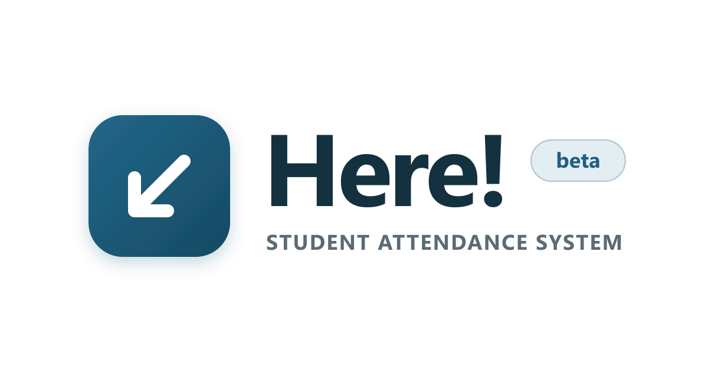

<p align="center">
  
</p>

<h1 align="center">Here! — Web Showcase & APK Portal</h1>

<p align="center">
  Official web showcase, release changelog, and Android APK download portal for <strong>Here!</strong>, a face-scan attendance app built for student organizations.
  <br />
  <a href="https://youre-here.vercel.app"><strong>youre-here.vercel.app</strong></a> · <a href="https://github.com/Meowtys/here-releases/releases/latest"><strong>Latest Android APK</strong></a> · <a href="https://youre-here.vercel.app/changelog"><strong>Changelog</strong></a>
</p>

---

## Overview

**Here!** is an Android attendance system designed for student organizations, university clubs, and campus events. Attendance checkers scan faces at time-in and time-out—on-device facial recognition identifies returning attendees on the spot, walk-ins can register as they arrive, and records sync when a connection is available.

This repository (`here-web`) powers the public web portal at [youre-here.vercel.app](https://youre-here.vercel.app):

- **Interactive App Showcase** — 15-screen guided preview covering group workspaces, live face-scan check-ins, walk-in registration, multi-session events, turnout analytics, role permissions, and audit logs.
- **Direct APK Distribution** — Pulls release metadata from [`Meowtys/here-releases`](https://github.com/Meowtys/here-releases) at build time and hydrates the latest version, file size, release date, and SHA-256 checksum on the client.
- **Sideloading & Verification Guide** — Step-by-step Android installation instructions with one-click SHA-256 checksum copy.
- **Release Changelog & Legal Pages** — Version history (`/changelog`), Privacy Policy (`/privacy`), and Terms of Use (`/terms`).

## Pages

| Route | Description |
| :--- | :--- |
| `/` | Landing page, interactive 15-screen product showcase, feature overview, quick-start workflow, and APK download card |
| `/changelog` | Release history and version notes |
| `/privacy` | Privacy Policy covering on-device face embeddings, camera usage, and organization data |
| `/terms` | Terms of Use for organizers, attendance checkers, and attendees |

## Tech Stack

- **Framework:** [Astro 5](https://astro.build/) (static output)
- **Styling:** [Tailwind CSS 3](https://tailwindcss.com/)
- **Testing:** Node.js built-in test runner (`node --test`)
- **Deployment:** [Vercel](https://vercel.com/)

## Local Development

### Prerequisites

- Node.js 20+ and npm

### Commands

```bash
# Install dependencies
npm install

# Start local dev server at http://localhost:4321
npm run dev

# Build static production site to dist/
npm run build

# Run verification test suite
npm test
```

## Project Structure

```text
here-web/
├── public/
│   └── assets/
│       ├── brand-mark.png      # Horizontal brand lockup
│       ├── logo.png            # App icon
│       ├── og-image.png        # 1200×630 Open Graph banner
│       └── showcase/           # App screenshots for the interactive showcase
├── scripts/
│   ├── build.mjs               # Astro build wrapper + clean-URL flat HTML output
│   └── generate-og-image.mjs   # Generates public/assets/og-image.png via Sharp
├── src/
│   ├── components/             # Navbar, AppShowcase, Footer
│   ├── data/                   # Release fallback metadata, changelog, showcase screens
│   ├── layouts/                # BaseLayout with SEO & Open Graph tags
│   ├── pages/                  # /, /changelog, /privacy, /terms
│   └── styles/                 # Global styles and typography
└── tests/
    └── site-data.test.mjs      # Asset, metadata, and build output checks
```

## Related Repositories

- **[Meowtys/here-releases](https://github.com/Meowtys/here-releases)** — Public Android APK binaries, SHA-256 checksums, and release channel.

## License

The website source code in this repository is licensed under the [MIT License](LICENSE).

The **Here!** name, logos, brand assets, app screenshots (`public/assets/`), and compiled Android APK binaries distributed via [`Meowtys/here-releases`](https://github.com/Meowtys/here-releases) are **All Rights Reserved** and governed by the [Terms of Use](https://youre-here.vercel.app/terms).
